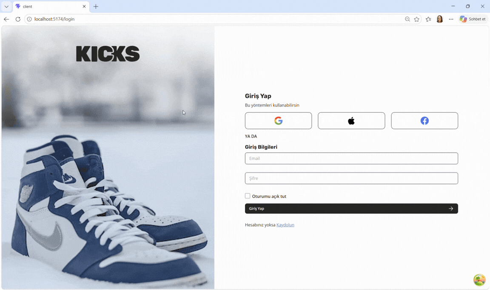

# 👟 Kicks – Shoe E-Commerce Platform

A modern full-stack shoe e-commerce application built with React 19, TypeScript, TanStack Query, Node.js, Express, and MongoDB. The application features product browsing, detailed product pages, JWT-based authentication, role-based authorization, and an admin dashboard for product management.

## ✨ Features

- 👟 Product listing with a modern card-based layout
- 🔍 Detailed product pages with image galleries, colors, sizes, and descriptions
- 🏷️ Discount badges and new product labels
- 🔐 User registration, login, and logout functionality
- 🛡️ JWT-based authentication with access and refresh tokens
- 🍪 HTTP-only cookie-based token management
- 🔒 Protected routes and role-based authorization
- 👤 Separate permissions for users and administrators
- ⚙️ Admin dashboard for product management
- ➕ Create, update, and delete products
- ✅ Form handling and validation with Formik and Yup
- 🔄 Data fetching, caching, and mutations with TanStack Query
- 🌐 Axios integration with interceptors and automatic token refresh
- 🛡️ XSS protection with DOMPurify
- 🔔 User notifications with React Toastify
- 📱 Responsive design with Tailwind CSS
- ⚡ Loading and error state management

## 🛠️ Tech Stack

### Frontend

- React 19
- TypeScript
- Vite
- Tailwind CSS
- React Router DOM
- TanStack Query
- Formik & Yup
- Axios
- React Toastify
- Lucide React
- DOMPurify

### Backend

- Node.js
- Express.js
- MongoDB Atlas
- Mongoose
- JSON Web Token (JWT)
- Cookie Parser
- bcryptjs
- Express Validator
- CORS

## 🏗️ Project Architecture

The application follows a client-server architecture:

- **Frontend:** Handles UI rendering, routing, form validation, and API communication.
- **Backend:** Provides RESTful API endpoints, authentication, authorization, and business logic.
- **Database:** MongoDB Atlas manages user accounts and product data.

## 🔐 Authentication & Security

- JWT-based access and refresh token authentication.
- Automatic access token renewal.
- HTTP-only cookies for secure token handling.
- Protected frontend routes.
- Backend authentication and authorization middleware.
- Role-based access control for administrative operations.
- HTML sanitization with DOMPurify to prevent XSS attacks.

## 🎯 Project Goals

This project was developed to gain practical experience in:

- Building scalable and reusable React applications.
- Developing type-safe applications with TypeScript.
- Creating RESTful APIs with Node.js and Express.
- Implementing secure authentication and authorization.
- Managing server state with TanStack Query.
- Integrating MongoDB Atlas with Mongoose.
- Developing responsive and user-friendly interfaces.
- Applying security practices in full-stack web development.

## 🎬 Preview

